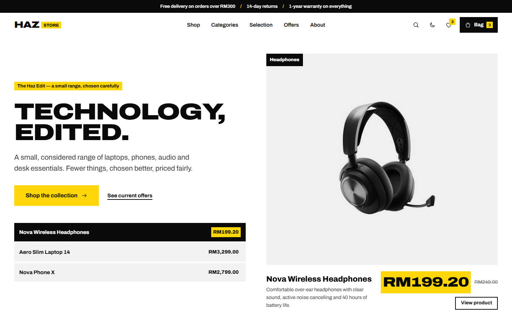

# Haz Store – E-commerce Frontend

[](https://github.com/hazell-lab/haz-store/actions/workflows/ci.yml)

Haz Store is a responsive e-commerce frontend for a fictional electronics shop, with a bold, product-first look: black and white, one signal yellow, and a heavy grotesk typeface. Version 2 rebuilds the original vanilla JavaScript site as a **React + Vite** single page app with real routes, reusable components, custom hooks and an automated test suite.

It is a portfolio project. Products, prices and stock are sample data, and the checkout is a clearly labelled demo: no order is sent anywhere, no payment is taken and nothing is shipped.

**[🔗 Live Demo](https://hazstore-ecommerce.netlify.app/)** · [Source code](https://github.com/hazell-lab/Haz-Store) · [Portfolio](https://hazimaqil-portfolio.netlify.app)



## Features

**Shopping**

- Home page with a product spotlight, departments, editor's selection, offers, top rated (by real rating data) and recently viewed
- Shop page with search, several categories at once, a price range slider, rating and availability filters that all combine, five sort options, a result count, removable filter chips, "clear all", an empty state and "show more" paging
- Filters live in the URL (`/shop?category=Mice,Laptops&max=300`), so results can be shared, bookmarked and restored with the back button; old links with fixed price ranges still work
- Header search with live product suggestions (keyboard friendly combobox)
- Product pages (`/product/:id`) with image zoom, price and discount, stock, quantity selector, add to bag, wishlist, a details list built only from real product fields, related products and recently viewed
- Compare up to three products side by side (`/compare`): price, discount, rating, stock, category and description

**Bag, wishlist and checkout**

- Slide-in bag drawer and a full bag page, with quantity limits based on stock and a free shipping progress bar (free from RM300, otherwise RM10)
- Wishlist page with a heart toggle on every product card and "Move all to bag" (out of stock products stay saved)
- Recently viewed products (newest first, no duplicates, last six)
- Demo checkout with field validation (Malaysian phone numbers, 5-digit postcodes), a loading state and a confirmation that survives a page refresh; no card or bank details are ever asked for
- One openly shown demo promo code (`HAZDEMO10`, 10% off the subtotal; free shipping is counted after the discount)
- Demo order history (`/orders`) with "Buy again"; it keeps only products, prices and the order number, never the name, email or address
- Bag, wishlist, recently viewed, comparison, demo orders and theme are saved in local storage, checked against the catalog on load and kept in sync between tabs

**Quality**

- Loading skeletons, an error state with "try again", empty states and a 404 page
- Light and dark theme (follows the system setting, choice is saved)
- Keyboard accessible throughout: focus moves to the page heading after navigation, drawers trap focus and close with Escape, labels and live regions everywhere
- Animations are turned off for users who enable "reduce motion"
- Pages other than home are code split and load on first visit
- Self-hosted, preloaded font and WebP photos; space is reserved while content loads, so the page does not jump
- Page titles and descriptions per route, a link preview image, `robots.txt` and a `sitemap.xml` generated from the catalog at build time

## Technologies

- React 19 and React Router 7
- Vite 8
- Vitest, React Testing Library, user-event and jest-dom (jsdom), with V8 coverage
- Playwright and axe-core for browser and accessibility tests
- ESLint (with the React hooks rules) and Prettier
- GitHub Actions for continuous integration
- CSS with custom properties, grid and flexbox (no CSS framework)
- Archivo variable font, self-hosted with Fontsource, and inline SVG icons

## Getting started

You need [Node.js](https://nodejs.org/) 22.12 or newer (Vitest needs it; Vite alone runs on 20.19+).

```bash
git clone https://github.com/hazell-lab/Haz-Store.git
```

```bash
cd Haz-Store
```

```bash
npm install
```

| Command                 | What it does                                            |
| ----------------------- | ------------------------------------------------------- |
| `npm run dev`           | Start the dev server at http://localhost:5173           |
| `npm run build`         | Build the production site into `dist/`                  |
| `npm run preview`       | Serve the production build at http://localhost:4173     |
| `npm test`              | Run the unit and DOM tests once                         |
| `npm run test:watch`    | Run them in watch mode                                  |
| `npm run test:coverage` | Run them with a coverage report (`coverage/index.html`) |
| `npm run test:e2e`      | Build the site and run the Playwright browser tests     |
| `npm run lint`          | Check the code with ESLint                              |
| `npm run format`        | Format every file with Prettier                         |
| `npm run check`         | Lint, format check, unit tests and build (what CI runs) |

On Windows PowerShell 5.1, run commands one at a time (`&&` is not supported there). `npm run check` works everywhere, because npm runs its steps itself.

The browser tests use your installed Google Chrome. Without Chrome, download Playwright's own browser once:

```bash
npx playwright install chromium
```

## Environment variables

None. The app has no backend, API keys or secrets. Products are loaded from the static file `public/data/products.json`.

## Project structure

```
Haz-Store/
├── index.html                 # vite entry (theme script, meta tags, root element)
├── public/
│   ├── _redirects             # netlify: send every route to the app
│   ├── robots.txt             # search engine rules (sitemap is built by vite)
│   ├── og-image.jpg           # link preview image
│   ├── assets/images/         # product photos (webp)
│   └── data/products.json     # the product catalog
├── src/
│   ├── main.jsx               # renders the app
│   ├── App.jsx                # providers and routes
│   ├── config.js              # store rules (shipping, limits, storage keys)
│   ├── components/            # header, footer, cards, drawer, filters, forms...
│   ├── context/               # catalog, store (bag/wishlist/recent), toasts, ui
│   ├── hooks/                 # useCart, useWishlist, useRecentlyViewed,
│   │                          # useProductFilters, useLocalStorage, useDialog...
│   ├── pages/                 # home, shop, product, bag, wishlist, checkout,
│   │                          # compare, demo orders, 404
│   ├── services/              # loads and checks the catalog json
│   ├── styles/                # design tokens and styles, split by area
│   ├── utils/                 # pricing, filters, cart maths, orders, validation
│   └── test/                  # test setup and helpers
├── e2e/                       # playwright browser and accessibility tests
├── .github/workflows/ci.yml   # lint, tests, build and browser tests on every push
├── docs/                      # screenshot
├── eslint.config.js
├── netlify.toml
├── playwright.config.js
└── vite.config.js             # build, tests, sitemap and font preload
```

Business rules (prices, filters, cart totals, validation) are plain functions in `src/utils`, so they are easy to test and reuse. Components stay small and get their data from hooks.

## Tests

`npm test` runs 91 tests in 14 files (about 89% of lines covered):

- unit tests for pricing, price formatting, search, every filter and sort, URL filter parsing (including old links), cart maths, the promo discount, adding several products at once, saved data cleaning, order history, recently viewed order, form validation and the catalog loader
- DOM tests that render the whole app and use it like a person would: filtering and clearing, search suggestions, adding to the bag, quantity and stock limits, wishlist and "move all", compare, product pages, the demo checkout (errors, promo code, loading, confirmation, keeping it after a refresh), order history and "buy again", loading and error states, the mobile menu and the 404 page

`npm run test:e2e` runs 44 Playwright tests against the production build, on a desktop and a phone screen (88 runs; one phone-only test is skipped on desktop):

- every page opens directly from its link without console errors, robots.txt and the sitemap are served, no page scrolls sideways
- filters, chips, the back button, "show more", header search, the mobile filter sheet, the bag drawer (totals, focus trap, Escape), stock limits, saving across reloads, the wishlist, the demo checkout and order history
- axe-core finds no WCAG 2.1 A/AA or best practice problems on 10 pages, in light and dark themes

## Continuous integration

`.github/workflows/ci.yml` runs on every push to `main` and on pull requests: ESLint, the Prettier check, unit tests with coverage, the production build, and the Playwright tests in Chromium. The coverage report is kept as a download on each run, and so is the Playwright report when a browser test fails.

## Deployment (Netlify)

`netlify.toml` already holds the settings: build command `npm run build`, publish folder `dist`, and a redirect that sends every route to `index.html` so links like `/product/3` work on refresh. Connect the repository in Netlify and it builds on every push.

## Lighthouse

Run on the production build (`npm run preview`) on 24 November 2026, Lighthouse 12:

| Page    | Mobile (perf / a11y / best practices / SEO) | Desktop               |
| ------- | ------------------------------------------- | --------------------- |
| Home    | 97 / 100 / 100 / 100                        | 100 / 100 / 100 / 100 |
| Shop    | 96 / 100 / 100 / 100                        | 100 / 100 / 100 / 100 |
| Product | 97 / 100 / 100 / 100                        | 100 / 100 / 100 / 100 |

The bag and checkout pages score lower on SEO on purpose: `robots.txt` keeps them out of search results. Scores on the live site can differ a little because of network conditions.

## Adding products

Add an object to the `products` array in `public/data/products.json` and put the photo in `public/assets/images/` (WebP is smallest, JPG and PNG also work):

```json
{
  "id": 21,
  "name": "Nova Speaker Mini",
  "category": "Accessories",
  "price": 119,
  "discount": 0,
  "rating": 4.3,
  "stock": 20,
  "image": "/assets/images/product-21.webp",
  "description": "Small Bluetooth speaker with deep bass.",
  "featured": false
}
```

- `id` must be unique and `category` must match a name in `categories`
- `discount` is a percentage; the sale price is calculated
- `featured: true` puts the product in the editor's selection and the hero spotlight
- Entries with missing fields are skipped instead of breaking the page; a missing image shows a placeholder

## Design

- **Type:** Archivo only, as a variable font. Headings, the logo and big prices use the expanded width at weight 800–900; body text and labels use the normal width.
- **Colour:** white `#ffffff` and black `#0a0a0a`, product tiles on light grey `#f0f0f0`, and one accent, signal yellow `#ffd60a`, always behind black text. The dark theme uses true black with the same yellow.
- **Shape:** hard 0px corners, 2px borders and no soft shadows.
- **Contrast:** black on yellow is about 14:1, and secondary text meets WCAG AA in both themes.

## Future improvements

- Real backend, accounts and order history
- A real payment provider (in its test mode first)
- Product reviews and more photos per product
- Product data such as specs and release dates, so "new arrivals" and spec tables can be shown honestly

## Author

Built by **Hazim Aqil**, Software Engineering student at the German-Malaysian Institute (GMI).

- Portfolio: [hazimaqil-portfolio.netlify.app](https://hazimaqil-portfolio.netlify.app)
- GitHub: [@hazell-lab](https://github.com/hazell-lab)
- LinkedIn: [mdhazimaqil](https://www.linkedin.com/in/mdhazimaqil/)
